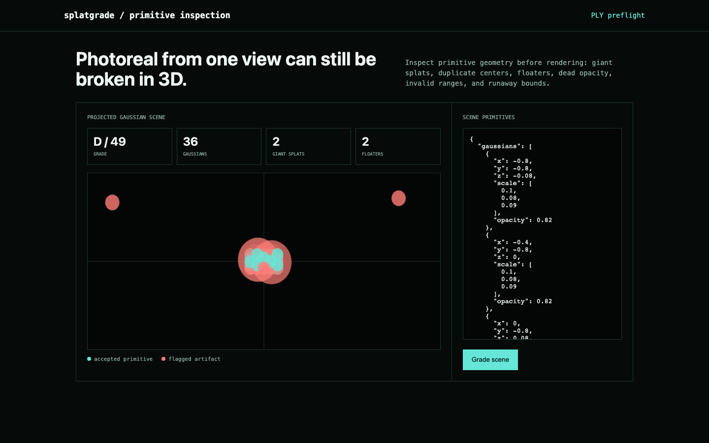

# splatgrade

[](https://github.com/ahmeddoghri/splatgrade/actions/workflows/tests.yml) [](https://adoghri.com/project-60.html)

**3D Gaussian Splat artifact quality gate.**

Inspect Gaussian PLY scenes for giant primitives, duplicates, low opacity, floaters, invalid ranges, and unstable bounds.




## What ships

- Real ASCII PLY parser with standard log-scale and opacity handling
- Robust scene-center, median-scale, MAD floater, duplicate, bounds, and metadata checks
- Projected scene preview with flagged primitives
- CLI, JSON API, responsive workbench, Docker, tests

## Run it end to end

```bash
python -m venv .venv && source .venv/bin/activate
python -m pip install -e .
splatgrade demo
splatgrade scan point_cloud.ply
splatgrade serve
```

## Demo result

The 36-primitive fixture contains two giant splats, three duplicate pairs, four near-transparent primitives, and two distant floaters. The deterministic penalty model assigns quality 49 and grade D.

## Current basis

- [AAA-Gaussians, ICCV 2025](https://doi.org/10.1109/ICCV51701.2025.02567)
- [Perceptual Quality Assessment of 3D Gaussian Splatting](https://ojs.aaai.org/index.php/AAAI/article/download/37928/41890)

## Update: fixed a crash and a silent-corruption bug in the PLY parser

Two real defects in `parse_ply`, both undermining the tool's core job of
catching bad scene data before it reaches a pipeline:

1. A bare `element` header line (missing its name, e.g. a truncated or
   hand-edited header) indexed `parts[1]` directly and crashed with an
   uncaught `IndexError` instead of a clean rejection.
2. A vertex row with fewer fields than declared properties (e.g. a row
   truncated mid-write, missing its trailing `opacity` value) silently
   zipped short — the missing field defaulted to a "safe" value (opacity
   1.0, full scale) instead of being flagged. A corrupted or truncated
   `.ply` could pass straight through as a clean, fully-opaque, quality-100
   scene.

Verified both directly against hand-built malformed fixtures. Fixed by
raising a clear `ValueError` in each case instead of crashing or silently
defaulting. `tests/test_malformed_ply.py` covers both cases plus a
complete-row control and a demo-output regression check; the published
demo numbers (quality 49, grade D, 2 giant/3 duplicate pairs/4 low-opacity/2
floaters) are unaffected.

## Scope

Primitive-level preflight catches structural artifacts. Final perceptual quality still requires rendered multi-view inspection against capture references.

## Test

```bash
python -m unittest discover -s tests -v
```

MIT licensed.
